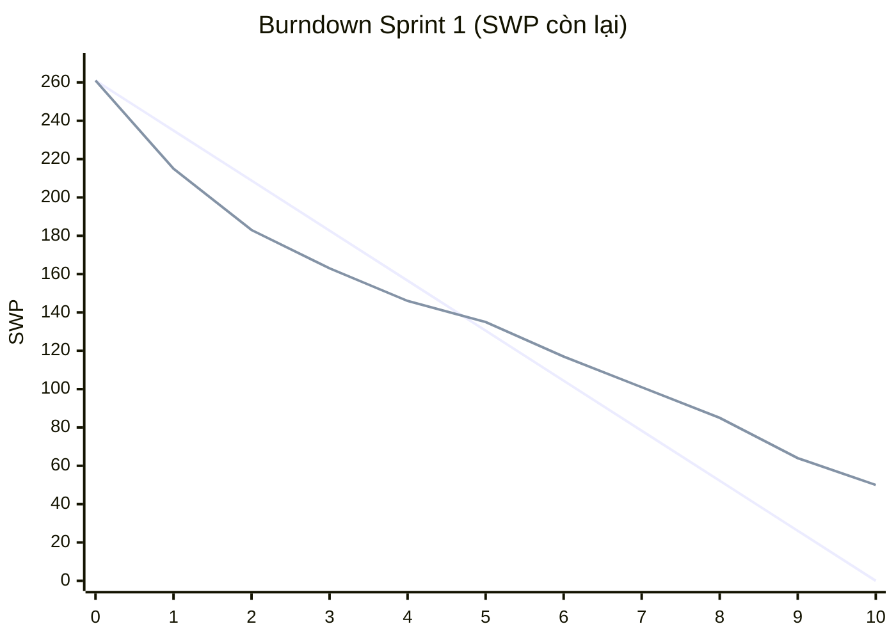

# Báo cáo tiến độ — Sprint 1

## 1. Phạm vi báo cáo

- **Iteration:** trường Iteration trên Project tên là **"Sprint 1"**, 2026-10-05 → 2026-10-16 (10 ngày làm việc). Cả dự án có 12 sprint hai tuần, Sprint 12 kết thúc 2027-03-19.
- **Đây là giả lập.** Hôm nay (2026-10-20) dự án đang ở **Sprint 2** (2026-10-19 → 2026-10-30); chưa ai làm Sprint 1 thật. Kết quả Sprint 1 do `tools/simulate-sprint-1.py` dựng theo một kịch bản viết trước (việc nào xong ngày nào, việc nào kẹt vì sao) rồi ghi vào trường Status của Project, đóng các issue đã xong. Số liệu dưới đây phản ánh kịch bản đó, không phải số đo thật.
- Cam kết của Sprint 1: **38 việc lá, 261 SWP, 440,5 giờ**: 19 việc dev/QA/PM của nền tảng E01 (cộng một issue làm rõ của E02; 116 SWP, 250,5 giờ) và 19 task `[BrSE]` review spec (145 SWP, 190 giờ) cho các issue có dev bắt đầu ở Sprint 1 hoặc Sprint 2 (E01, E02). Đội giả định: PM, BrSE1–BrSE4, BE1–BE3, FE1, QA1–QA2, INFRA1; năng lực 60 giờ tập trung mỗi người mỗi sprint (PM 30). BrSE3 và BrSE4 chỉ có việc ở Sprint 1 (cao điểm review đầu dự án); từ Sprint 2 chỉ còn BrSE1 và BrSE2.

## 2. Trạng thái

Tổng SWP chỉ cộng trên việc lá (issue cha và epic đã bằng tổng con, cộng lên sẽ đếm trùng).

**Phạm vi Sprint 1:**

| Trạng thái | Số issue | Tổng SWP | Ghi chú |
|---|---:|---:|---|
| Done | 30 | 211 | Việc dev: #3, #14, #15, #16, #6, #18, #23, #26, #30, #39, #41, #49 (12 việc, 76 SWP). Review spec: 18 task `[BrSE]` của E01 và E02 (135 SWP), ví dụ #423, #425, #435. Issue đã đóng |
| In Progress | 6 | 41 | #48 (KH chưa trả lời chiến lược RLS) kéo theo #10, #11 bị chặn và review spec #424 chưa chốt được; #7 (chuyển migration khó hơn dự kiến); #4 (chờ AWS duyệt hạn mức ECS/ECR). Chuyển sang Sprint 2 |
| Todo | 2 | 9 | #12 (test phân quyền chờ RLS), #83 (PM dồn sức cho #48) |
| **Cộng** | **38** | **261** | Hoàn thành **211/261 = 81%**. Riêng việc dev/QA/PM: 76/116 = 66%; riêng review spec: 135/145 = 93% |

**Toàn Project (540 mục sau Sprint 1):**

| Trạng thái | Số mục (cả epic, issue, sub-issue) | Việc lá | SWP (việc lá) |
|---|---:|---:|---:|
| Done | 31 | 30 | 211 |
| In Progress | 26 | 6 | 41 |
| Todo | 483 | 384 | 1976 |
| **Cộng** | **540** | **420** | **2228** |

Done có 31 mục vì ngoài 30 việc lá còn #13 (issue cha có đủ con đã xong). In Progress 26 mục gồm 6 việc lá, các issue cha đã có con bắt đầu và epic #1, #50. Tính theo SWP, dự án mới xong 211/2228 ≈ 9,5%.

## 3. Burndown Sprint 1

SWP còn lại của phạm vi cam kết (261 SWP) theo ngày làm việc. Đường thứ nhất là lý tưởng (giảm đều), đường thứ hai là thực tế.

| Ngày | Lý tưởng | Thực tế | Xong trong ngày |
|---:|---:|---:|---:|
| 0 | 261 | 261 | - |
| 1 | 234,9 | 215 | 46 |
| 2 | 208,8 | 183 | 32 |
| 3 | 182,7 | 163 | 20 |
| 4 | 156,6 | 146 | 17 |
| 5 | 130,5 | 135 | 11 |
| 6 | 104,4 | 117 | 18 |
| 7 | 78,3 | 101 | 16 |
| 8 | 52,2 | 85 | 16 |
| 9 | 26,1 | 64 | 21 |
| 10 | 0 | 50 | 14 |

**Thực tế lệch kế hoạch ở đâu:** hai ngày đầu BrSE review xong spec cho 10 issue có dev bắt đầu ngay Sprint 1 (78 SWP), nên đường thực tế nằm dưới đường lý tưởng tới ngày 4. Từ ngày 5 phần còn lại là việc dev của E01 và review cho các issue của Sprint 2; việc dev đầu tiên (#3) chỉ xong ngày 3 vì INFRA1 còn dựng AWS và RDS, nên tốc độ không đủ và đường thực tế vượt lên trên lý tưởng, khoảng cách giãn tới 50 SWP ở ngày 10. Ba việc (#10, #11, #12, 18 SWP) và review spec #424 (10 SWP) kẹt vì quyết định RLS (#48) chưa có. Việc chuyển migration (#7, 10 SWP) khó hơn ước lượng ở quyền thực thi của RPC. Việc dựng ECS (#4, 6 SWP) còn chờ AWS duyệt hạn mức nên chưa xong. Kết quả còn 50 SWP tồn, velocity 211/261 = **81%** (riêng việc dev 66%).

## 4. Rủi ro trễ

**Mốc (suy từ kế hoạch trong dữ liệu Project; mỗi sprint kết thúc vào thứ Sáu):**

| Mốc | Tên | Hạn | Căn cứ |
|---|---|---|---|
| M1 | Nền tảng E01 xong | Cuối Sprint 4, 2026-11-27 | Việc lá cuối của #1 (giám sát, canary, TLS/KMS) nằm ở Sprint 4; lõi (migration, container, lịch job, worker) xong ở Sprint 2 (2026-10-30) |
| M2 | Luồng 相対取引 end-to-end | Cuối Sprint 6, 2026-12-25 | Việc lá cuối của #137 ở Sprint 6; #85, #103, #116 xong trước đó |
| M3 | 47/53 màn xong | Cuối Sprint 11, 2027-03-05 | 47 màn có mọi việc lá xong trước hoặc trong Sprint 11; 6 màn còn lại (#324, #347, #350, #374, #377, #380) rơi vào Sprint 12 |
| M4 | Đủ 53 màn, hồi quy xong, sẵn sàng go-live | Cuối Sprint 12, 2027-03-19 | Hồi quy cuối (#412) và 6 màn còn lại cùng ở Sprint 12 |

Sprint 2 chạy 2026-10-19 → 2026-10-30; Sprint 3: 11-02 → 11-13.

| Rủi ro | Issue | Ảnh hưởng tới mốc nào | Hành động | Ai làm, khi nào |
|---|---|---|---|---|
| KH chưa trả lời chiến lược RLS | #48 chặn #10, #11, #12; về sau chặn mọi truy cập dữ liệu có phân quyền đọc | M1, rồi M2 | Gửi nhắc có hạn trả lời; nếu tới hạn chưa có thì dùng giả định GĐ03 (giữ RLS đọc bằng biến phiên) để các việc không bị đứng | PM: nhắc 2026-10-21, chốt hạn 2026-10-23; BE2, BE3 làm tiếp theo GĐ03 từ 2026-10-26 |
| Chuyển migration khó hơn dự kiến: quyền EXECUTE của RPC cần vai trò DB mới | #7 | M1; E01 trượt thì E02 (14 việc ở Sprint 2) và E04 bắt đầu muộn | Ghép BE1 với INFRA1; chạy thử toàn bộ migration trên staging; cấp EXECUTE cho vai trò ứng dụng theo GĐ08 | BE1, INFRA1: chạy thử xong 2026-10-23; PM xét hết Sprint 2 (2026-10-30), chưa qua thì cắt bớt việc E02 sang Sprint 3 |
| Hạn mức ECS/ECR chờ AWS duyệt | #4 | M1 (ảnh hưởng #19, #27 xếp sau) | Xin tăng hạn mức lần nữa kèm số liệu cần; làm tiếp phần không cần hạn mức mới | INFRA1: gửi yêu cầu 2026-10-20; PM theo dõi 2026-10-22 |
| Sprint 2 quá tải do việc chuyển sang | 8 việc chuyển từ Sprint 1 (96,5 giờ, gồm review spec #424 13 giờ) cộng Sprint 2: BE1 82,5 giờ, BE3 72 giờ, INFRA1 67,5 giờ, BrSE1 72 giờ so với trần 60 | M1 | Đưa việc chuyển sang vào kế hoạch Sprint 2, đẩy việc nhẹ ưu tiên của BE1, BE3, INFRA1 sang Sprint 3; chuyển bớt review của BrSE1 sang BrSE2 (Sprint 2 mới có 23,5 giờ) | PM: họp lập kế hoạch Sprint 2 ngày 2026-10-21; BrSE1, BrSE2 chia lại review cùng ngày |
| Nút cổ chai QA và hồi quy cuối vượt năng lực: QA1 có 92 giờ ở Sprint 12 so với trần 60 | #417, #418 (mỗi việc 16 giờ) | M4 (đúng mốc go-live) | Thêm người QA hoặc tự động hóa hồi quy trước; dời việc hồi quy có thể làm sớm sang Sprint 11 (QA1, QA2 còn dư 16 giờ mỗi người) | PM: quyết định thêm QA ở buổi xem lại Sprint 6 (2026-12-25); QA1, QA2 soát lại kịch bản trước Sprint 10 (2027-02-08) |
| Test vector 完納奨励金 chưa có từ KH, tỷ lệ bậc còn MOCK | #285 (Sprint 4); ảnh hưởng #278, #415 | Ký nhận E11 (Sprint 10) rồi M4 | Gửi yêu cầu chính thức sớm; nếu tới 2026-11-27 chưa có thì giữ MOCK, ghi rõ vào tài liệu mock và báo cáo; kiểm thử bằng test vector tự dựng | PM: gửi yêu cầu 2026-10-26, leo thang 2026-11-27 |
| FE1 và QA2 không có việc nào ở Sprint 1, trong khi tải FE về sau rất cao: FE1 có 556,5 giờ ở Sprint 3–12 (khoảng 9 sprint việc cho một FE) | Toàn bộ việc [FE]; ví dụ #31 | M3, M4 | Kéo sớm các việc FE không cần chờ API (thành phần dùng chung); cân nhắc thêm FE thứ hai từ Sprint 5 | PM + FE1: soát việc kéo sớm 2026-10-21; quyết định FE thứ hai 2026-11-30 |
| 30 issue làm rõ đang chờ KH trả lời (79 SWP); chưa trả lời thì issue liên quan phải làm theo đề xuất | 30 issue `clarify`, ví dụ #83, #136, #334 | M2 (phần làm rõ ở E05, E06), M3, M4 | Gom câu hỏi theo epic, gửi theo lô; đặt hạn trả lời trước sprint có việc bị chặn; quá hạn thì lấy đề xuất trong issue làm giả định và ghi vào danh sách rủi ro | PM: lô đầu (9 issue làm rõ của Sprint 1–2) gửi 2026-10-23; các lô sau gửi đầu mỗi sprint |
| Có thể hiểu sai yêu cầu ở 4 epic có công số giảm mạnh so với LAB-1 (đã chặn mức giảm 30% trong `estimate.md`) | #85, #116, #182, #303 | M2, M3 | Đối chiếu lại yêu cầu RFP của từng epic trước khi làm; phát sinh việc thì dùng phần dự phòng 374,6 giờ ở `estimate.md` §5 | PM + BE1: E03 và E05 đã vào Sprint 2 nên soát ngay, xong 2026-10-23; E08 xong trước Sprint 3 (2026-11-02); E13 xong trước Sprint 5 (2026-11-30) |
| Review spec trễ thì dev của sprint sau phải chờ: BrSE1 ở mức 52–60 giờ (trần 60) ở 8/9 sprint đầu, không còn chỗ cho việc phát sinh | 104 task `[BrSE]`, ví dụ #460 (SCR-030, luồng chính) | M2, M3 | Mỗi sprint chốt danh sách review của sprint sau ở buổi lập kế hoạch; BrSE2 nhận phần vượt của BrSE1; review của issue luồng chính (E06) và 完納奨励金 (E11) làm trước trong sprint | PM + BrSE1, BrSE2: chốt ở mỗi buổi lập kế hoạch, bắt đầu 2026-10-21 |
